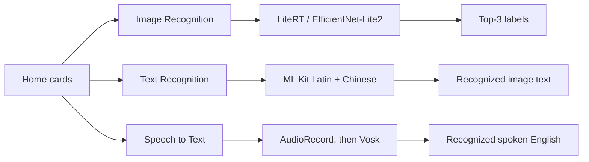
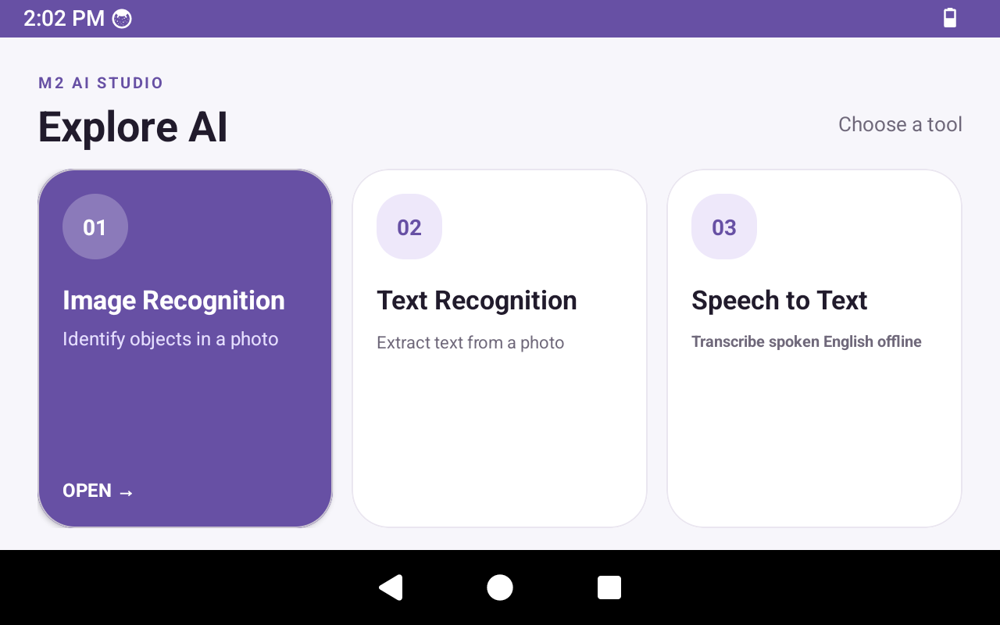
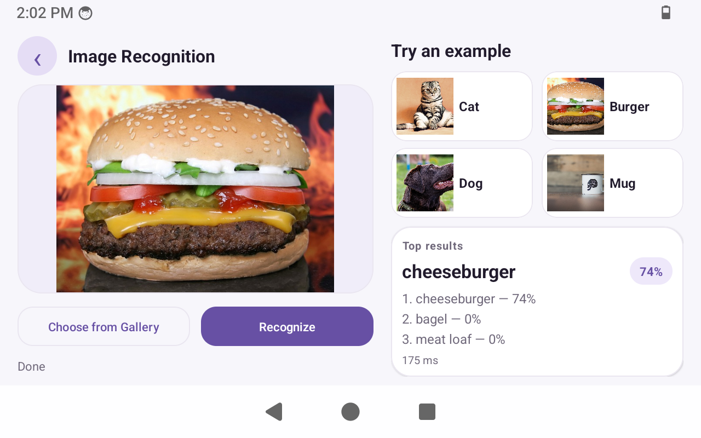
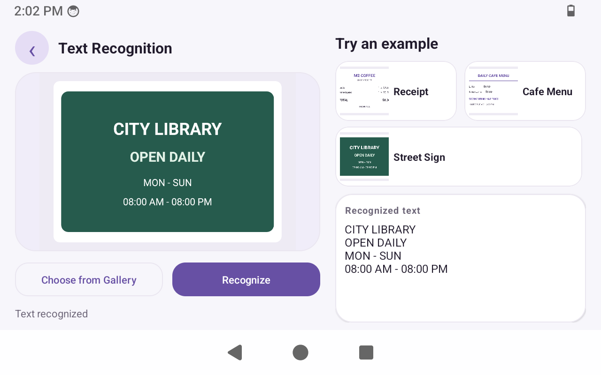
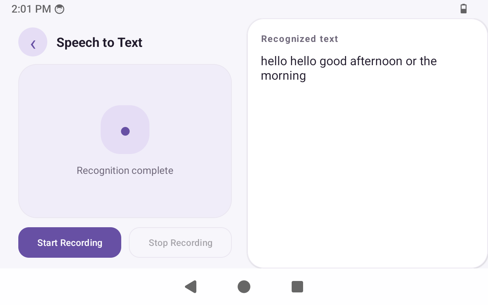

# M2 AI Demo

**English** | [简体中文](README.zh-CN.md)

M2 AI Demo is a landscape-friendly Android sample app for exploring on-device AI. It currently includes image classification, image text recognition, and offline English speech-to-text in a simple card-based UI.

> The app does not require Quectel M2 hardware privileges. AI inference runs on the Android device; no API key or cloud AI service is configured.

## Features

| Page | Function |
|---|---|
| Image Recognition | Choose a gallery image or one of four examples; run EfficientNet-Lite2 and show the top three ImageNet classifications with confidence and inference time |
| Text Recognition | Choose an image or try a generated receipt, cafe menu, or street-sign example; extract Latin or Chinese text with ML Kit |
| Speech to Text | Record speech and transcribe it after stopping with the bundled Vosk US English model, fully offline |

The UI has portrait and landscape layouts. Object detection is not implemented.

## Project structure and data flow

```text
M2AIDemo/
├── app/
│   ├── build.gradle.kts
│   └── src/
│       ├── main/
│       │   ├── java/com/quectel/m2aidemo/
│       │   │   ├── HomeActivity.kt              Feature-card navigation
│       │   │   ├── MainActivity.kt              Image selection and classification UI
│       │   │   ├── ImageClassifier.kt           LiteRT model loading and inference
│       │   │   ├── TextRecognitionActivity.kt   Gallery and ML Kit OCR flow
│       │   │   ├── OcrSampleImages.kt            Generated English OCR examples
│       │   │   └── SpeechToTextActivity.kt       Audio capture and Vosk inference
│       │   ├── res/
│       │   │   ├── layout/                      Portrait layouts
│       │   │   ├── layout-land/                 Landscape layouts
│       │   │   └── drawable-nodpi/              Image-classification examples
│       │   └── assets/
│       │       ├── efficientnet_lite2.tflite
│       │       ├── vosk-model-small-en-us-0.15.zip
│       │       └── THIRD_PARTY_NOTICES.txt
│       ├── test/                                JVM unit tests
│       └── androidTest/                         Device tests for image and OCR examples
├── gradle/libs.versions.toml
├── source/                                    Device screenshots embedded in this README
└── gradlew.bat
```

The three feature paths are independent:



### App screenshots



## Image Recognition: EfficientNet-Lite2

The image page accepts a gallery image or the built-in Cat, Burger, Dog, and Mug examples. The preview keeps the full image visible, including its EXIF orientation. Classification uses the LiteRT CPU runtime and the model's embedded metadata for input dimensions and labels.

The model returns the three highest-scoring ImageNet labels. Results include confidence and inference time. This is **image classification**, not object detection: it labels the overall image and does not draw bounding boxes or identify arbitrary objects outside its training classes. Accuracy depends on the image and model categories.



Gallery selection uses the Activity Result API to return an image URI, then follows the same load-and-classify path as the bundled examples:

```kotlin
imagePicker = registerForActivityResult(ActivityResultContracts.GetContent()) { uri ->
    if (uri != null) loadImage(uri)
}
chooseImageButton.setOnClickListener { imagePicker.launch("image/*") }
```

### Integrating and using the model file

Place the `.tflite` model in `app/src/main/assets/`, for example `efficientnet_lite2.tflite`. This model's metadata contains the input dimensions and an associated label file, so a separate label asset is not required. Add the LiteRT runtime and metadata dependencies:

The current model is the [Google AI Edge EfficientNet-Lite2 sample model](https://storage.googleapis.com/ai-edge/interpreter-samples/image_classification/android/efficientnet_lite2.tflite).

```kotlin
implementation("com.google.ai.edge.litert:litert:2.1.0")
implementation("com.google.ai.edge.litert:litert-metadata:1.0.0")
```

`ImageClassifier` reads the model metadata and creates a CPU-backed model:

```kotlin
val modelBytes = context.assets.open("efficientnet_lite2.tflite").use { it.readBytes() }
val metadata = MetadataExtractor(ByteBuffer.wrap(modelBytes))
inputHeight = metadata.getInputTensorShape(0)[1]
inputWidth = metadata.getInputTensorShape(0)[2]
labels = metadata.getAssociatedFile("labels_without_background.txt")
    .bufferedReader().useLines { lines ->
        lines.map { it.trim() }.filter { it.isNotEmpty() }.toList()
    }

model = CompiledModel.create(
    context.assets,
    "efficientnet_lite2.tflite",
    CompiledModel.Options(Accelerator.CPU),
    null
)
```

For inference, resize the bitmap to the model input shape and convert RGB channels to the expected floating-point input (this model uses `(channel - 127.5) / 127.5`). Run the model, map scores to labels, sort descending, and take the top three. The Activity invokes classification on a worker thread and updates the UI afterward:

```kotlin
val inputBitmap = Bitmap.createScaledBitmap(bitmap, inputWidth, inputHeight, true)
val pixels = IntArray(inputWidth * inputHeight)
inputBitmap.getPixels(pixels, 0, inputWidth, 0, 0, inputWidth, inputHeight)

val input = FloatArray(pixels.size * 3)
pixels.forEachIndexed { index, pixel ->
    val offset = index * 3
    input[offset] = (Color.red(pixel) - 127.5f) / 127.5f
    input[offset + 1] = (Color.green(pixel) - 127.5f) / 127.5f
    input[offset + 2] = (Color.blue(pixel) - 127.5f) / 127.5f
}

val inputBuffers = model.createInputBuffers()
val outputBuffers = model.createOutputBuffers()
val scores = try {
    inputBuffers[0].writeFloat(input)
    model.run(inputBuffers, outputBuffers)
    outputBuffers[0].readFloat()
} finally {
    inputBuffers.forEach { it.close() }
    outputBuffers.forEach { it.close() }
}

val scoreOffset = when (scores.size) {
    labels.size -> 0
    labels.size + 1 -> 1
    else -> error("Model output does not match the label count.")
}
val predictions = labels.indices
    .map { index -> labels[index] to scores[index + scoreOffset] }
    .sortedByDescending { it.second }
    .take(3)
```

Gallery and example images use the same `classify(bitmap)` path. When replacing the model, verify its input layout, data type, normalization, output tensor, and label order; swapping only the `.tflite` file is not sufficient.

## Text Recognition: ML Kit

The OCR page accepts gallery images and three generated examples: Receipt, Cafe Menu, and Street Sign. `OcrSampleImages` draws the examples at runtime, so no additional OCR image files are needed.

Latin and Chinese ML Kit recognizers process the image in parallel. If the Chinese result contains Han characters, that result is shown; otherwise the Latin result is preferred. The recognized text is selectable in the result panel.



### Integrating and calling the recognizers

The app uses the ML Kit Latin and Chinese Text Recognition dependencies:

```kotlin
implementation("com.google.mlkit:text-recognition:16.0.1")
implementation("com.google.mlkit:text-recognition-chinese:16.0.1")
```

These ML Kit Android dependencies bundle the recognition models; no separate OCR model file needs to be downloaded or placed in the project.

The Activity creates both recognizers. Once a bitmap is available, wrap it in an `InputImage` and submit both recognition tasks:

```kotlin
latinRecognizer = TextRecognition.getClient(TextRecognizerOptions.DEFAULT_OPTIONS)
chineseRecognizer = TextRecognition.getClient(
    ChineseTextRecognizerOptions.Builder().build()
)

val image = InputImage.fromBitmap(bitmap, 0)
val latinTask = latinRecognizer.process(image)
val chineseTask = chineseRecognizer.process(image)
```

After both tasks complete, select the result based on detected script:

```kotlin
Tasks.whenAllComplete(latinTask, chineseTask).addOnCompleteListener(this) {
    val latinText = if (latinTask.isSuccessful) latinTask.result?.text.orEmpty() else ""
    val chineseText = if (chineseTask.isSuccessful) chineseTask.result?.text.orEmpty() else ""
    val recognizedText = when {
        chineseText.any { it in '\u4e00'..'\u9fff' } -> chineseText
        latinText.isNotBlank() -> latinText
        else -> chineseText
    }.trim()
    resultText.text = recognizedText
}
```

Tapping an example card generates a bitmap, updates the preview, and calls the same recognition method. The Activity closes both recognizers in `onDestroy()`. Since the examples are drawn with Android `Canvas`, their text, type, and layout can be changed without replacing image assets.

## Speech to Text: offline English

Speech recognition uses the bundled `vosk-model-small-en-us-0.15` model. The first time the page opens, the app unpacks the archive into its private app storage and initializes Vosk. This may take a little time and requires additional device storage; it does not download the model.

1. Tap **Start Recording** and grant microphone permission when prompted.
2. Speak in English.
3. Tap **Stop Recording**. The app processes the captured audio locally and displays the transcription.

Audio is captured as mono, 16 kHz, 16-bit PCM and held in memory until recording stops. The app does not save the recording or send it to a server. The bundled model is US English; recognition quality varies with accent, microphone quality, and background noise. Long recordings use more memory.



### Integrating the model and recording/transcribing

Place the Vosk archive at `app/src/main/assets/vosk-model-small-en-us-0.15.zip` and add the Vosk Android runtime and JNA dependencies:

Model downloads and license information are listed on the [Vosk Models](https://alphacephei.com/vosk/models) page.

```kotlin
implementation("com.alphacephei:vosk-android:0.3.75@aar")
implementation("net.java.dev.jna:jna:5.18.1@aar")
```

Declare microphone access in the manifest and request runtime permission when the user starts recording:

```xml
<uses-permission android:name="android.permission.RECORD_AUDIO" />
```

```kotlin
private val requestAudioPermission =
    registerForActivityResult(ActivityResultContracts.RequestPermission()) { granted ->
        if (granted) startRecording()
        else status.text = getString(R.string.speech_permission_denied)
    }
```

On a worker thread, `ZipInputStream` extracts the model into `filesDir`. The app checks required model files before initializing Vosk:

```kotlin
val modelDirectory = unpackModel()
val loadedModel = Model(modelDirectory.absolutePath)
model = loadedModel
```

`unpackModel()` validates archive paths, extracts only entries under the model directory, and installs the model after checking its required files. The archive is unpacked once; later page visits load the model from the app-private directory.

Android `AudioRecord` captures mono 16 kHz, 16-bit PCM. When the user stops, the app stops/releases the recorder and feeds the buffered PCM to Vosk in chunks:

```kotlin
val recorder = AudioRecord(
    MediaRecorder.AudioSource.MIC,
    16_000,
    AudioFormat.CHANNEL_IN_MONO,
    AudioFormat.ENCODING_PCM_16BIT,
    bufferSize
)
recorder.startRecording()
// A background capture thread repeatedly reads PCM into recordedAudio.
val count = recorder.read(buffer, 0, buffer.size, AudioRecord.READ_BLOCKING)
if (count > 0) recordedAudio.write(buffer, 0, count)
```

After recording stops, a worker performs Vosk inference:

```kotlin
val recognizer = Recognizer(model, 16_000f)
try {
    val buffer = ByteArray(8_192)
    var offset = 0
    while (offset < pcmAudio.size) {
        val count = minOf(buffer.size, pcmAudio.size - offset)
        System.arraycopy(pcmAudio, offset, buffer, 0, count)
        recognizer.acceptWaveForm(buffer, count)
        offset += count
    }
    val transcription = JSONObject(recognizer.finalResult)
        .optString("text")
        .trim()
} finally {
    recognizer.close()
}
```

`SpeechToTextActivity` performs capture and inference off the UI thread, starts final transcription when Stop is pressed, then posts the result and status to the screen. Offline models are language-specific. This app bundles US English; changing the language requires a corresponding model and a review of its sampling requirements, license, and APK size.

## Models, dependencies, and licenses

| Component | Purpose | License / terms |
|---|---|---|
| EfficientNet-Lite2 | Image classification | Apache-2.0, as declared in model metadata |
| LiteRT Android | On-device image inference | Apache-2.0 |
| Google ML Kit Text Recognition | Latin and Chinese OCR | Google ML Kit Terms |
| Vosk Android 0.3.75 | Offline speech recognition runtime | Apache-2.0 |
| Java Native Access (JNA) 5.18.1 | Native bridge used by Vosk Android | LGPL-2.1-or-later or Apache-2.0 |
| Vosk small US English model 0.15 | Offline speech recognition model | Apache-2.0; about 40 MB compressed |

See [`app/src/main/assets/THIRD_PARTY_NOTICES.txt`](app/src/main/assets/THIRD_PARTY_NOTICES.txt) and [`app/src/main/assets/LICENSE-APACHE-2.0.txt`](app/src/main/assets/LICENSE-APACHE-2.0.txt) for notices and license text. Example-image attributions are also recorded in the notices file.

## Build, install, and test

### Toolchain

- Windows with Android Studio or Android command-line build tools
- JDK 17 or newer (the project has been built with JDK 21)
- Android SDK Platform 36, API 36.1
- Android Gradle Plugin 9.2.1 and Gradle Wrapper 9.4.1
- Android device or emulator running API 26 or newer

From the project root in PowerShell:

```powershell
.\gradlew.bat :app:assembleDebug
adb devices
.\gradlew.bat :app:installDebug
.\gradlew.bat :app:testDebugUnitTest
.\gradlew.bat :app:connectedDebugAndroidTest
```

`connectedDebugAndroidTest` requires a connected device or emulator. The current instrumentation tests exercise the image-classification and OCR examples; microphone use should also be checked on the intended device.

## Current limitations

- Image Recognition uses a general ImageNet classifier. It is not a custom classifier, object detector, or guarantee of correct results for arbitrary photos.
- OCR is configured for Latin and Chinese text.
- Speech to Text currently recognizes US English only. It needs microphone permission and uses a small offline model; no cloud fallback is configured.
- The speech model is bundled in the app, increasing APK size by about 40 MB before native libraries and other assets are included.
- Object detection and additional AI features are not implemented.
