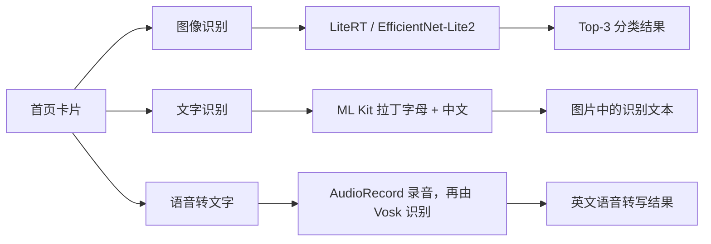
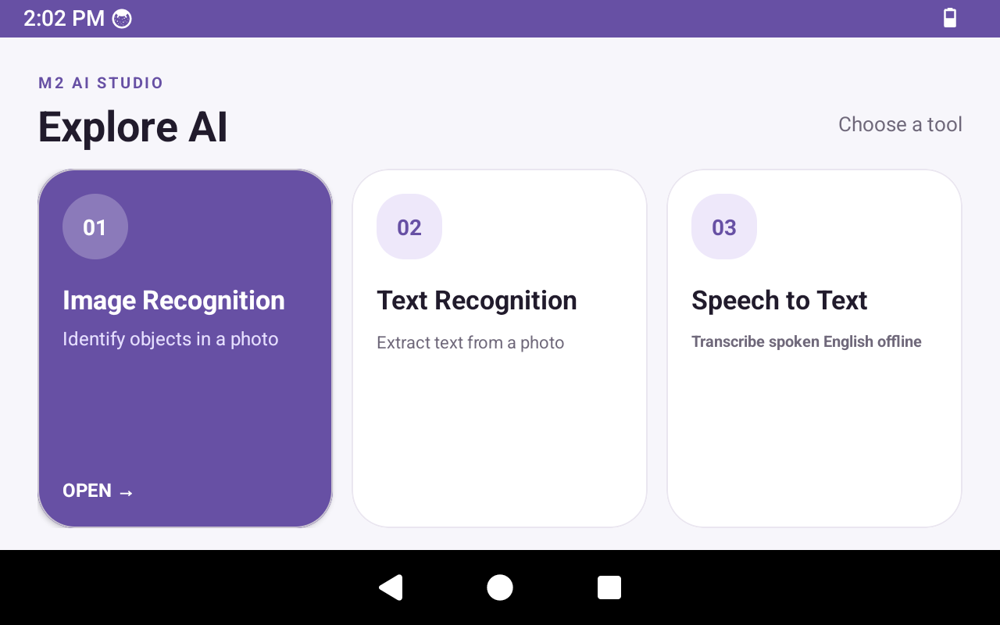
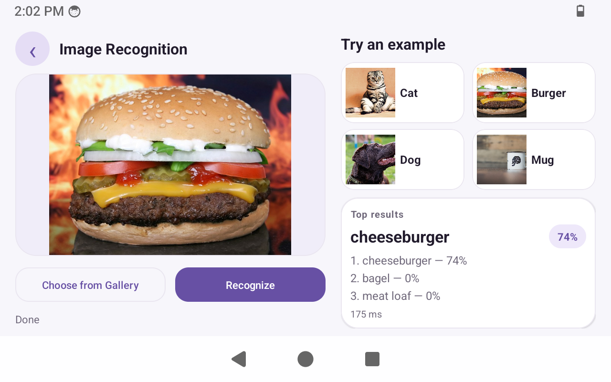
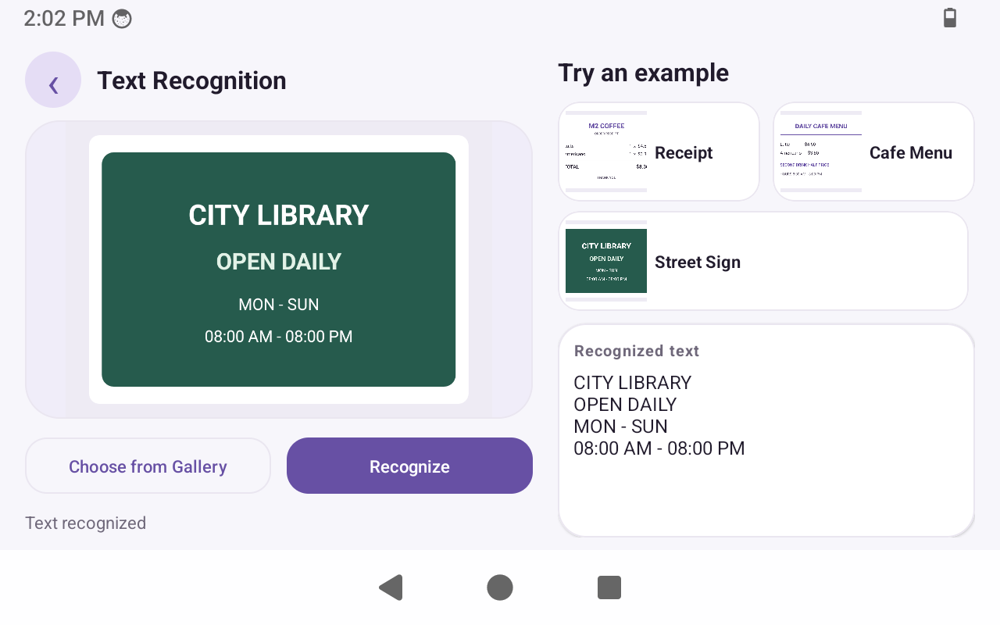
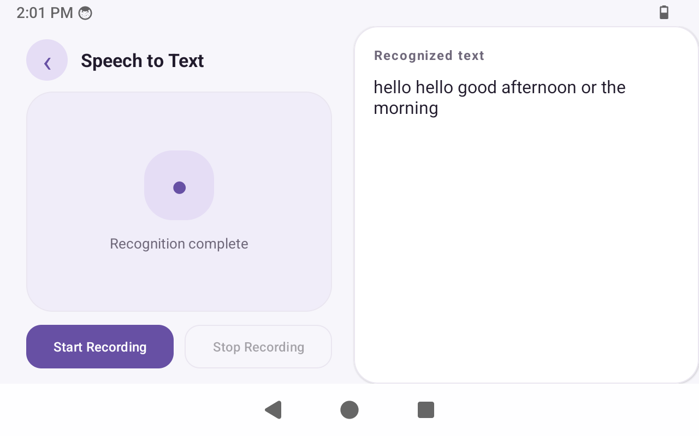

# M2 AI Demo

[English](README.md) | **简体中文**

M2 AI Demo 是一款以横屏体验为主的 Android 端侧 AI 示例应用，采用简洁的功能卡片首页。目前包含图像分类、图片文字识别和英文离线语音转文字。

> AI 推理在 Android 设备本地运行。

## 功能概览

| 页面 | 功能 |
|---|---|
| Image Recognition | 从相册选择图片或使用四张示例图；通过 EfficientNet-Lite2 显示 ImageNet 分类 Top-3、置信度和推理耗时 |
| Text Recognition | 选择图片，或尝试程序生成的 Receipt、Cafe Menu、Street Sign 示例；使用 ML Kit 识别拉丁字母或中文文本 |
| Speech to Text | 录音后点击停止，使用随应用打包的 Vosk 美式英语模型离线转写 |

界面包含横屏和竖屏布局。目标检测功能尚未实现。

## 项目结构和数据流

```text
M2AIDemo/
├── app/
│   ├── build.gradle.kts
│   └── src/
│       ├── main/
│       │   ├── java/com/quectel/m2aidemo/
│       │   │   ├── HomeActivity.kt              首页卡片和页面导航
│       │   │   ├── MainActivity.kt              图片选择和分类页面
│       │   │   ├── ImageClassifier.kt           LiteRT 模型加载和推理
│       │   │   ├── TextRecognitionActivity.kt   相册图片和 ML Kit OCR 流程
│       │   │   ├── OcrSampleImages.kt            动态生成英文 OCR 示例
│       │   │   └── SpeechToTextActivity.kt       录音和 Vosk 语音识别
│       │   ├── res/
│       │   │   ├── layout/                      竖屏布局
│       │   │   ├── layout-land/                 横屏布局
│       │   │   └── drawable-nodpi/              图像分类示例图
│       │   └── assets/
│       │       ├── efficientnet_lite2.tflite
│       │       ├── vosk-model-small-en-us-0.15.zip
│       │       └── THIRD_PARTY_NOTICES.txt
│       ├── test/                                JVM 单元测试
│       └── androidTest/                         图像分类和 OCR 示例设备测试
├── gradle/libs.versions.toml
├── source/                                    README 中展示的设备截图
└── gradlew.bat
```

三个功能分别使用独立的处理流程：



### 应用界面示例



## 图像识别：EfficientNet-Lite2

图像识别页面支持从相册选择图片，也提供 Cat、Burger、Dog、Mug 四张示例图。预览会完整显示图片并处理 EXIF 方向。分类通过 LiteRT CPU Runtime 执行，输入尺寸和标签从模型元数据中读取。

结果显示 ImageNet 分类中得分最高的三个标签，并列出置信度和推理耗时。这是**整图分类**，不是目标检测：它不会绘制边界框，也不能识别训练类别之外的任意物体。识别效果取决于图片内容和模型类别范围。



相册选择通过 Activity Result API 返回图片 URI，再沿用示例图相同的加载和分类流程：

```kotlin
imagePicker = registerForActivityResult(ActivityResultContracts.GetContent()) { uri ->
    if (uri != null) loadImage(uri)
}
chooseImageButton.setOnClickListener { imagePicker.launch("image/*") }
```

### 模型文件集成和使用

将 `.tflite` 文件放在 `app/src/main/assets/`，例如 `efficientnet_lite2.tflite`。本项目的模型元数据包含输入尺寸及关联标签文件，因此标签不需要另外维护。添加 LiteRT Runtime 和 Metadata 依赖：


```kotlin
implementation("com.google.ai.edge.litert:litert:2.1.0")
implementation("com.google.ai.edge.litert:litert-metadata:1.0.0")
```

`ImageClassifier` 先读取模型元数据，再创建 CPU 模型实例：

```kotlin
val modelBytes = context.assets.open("efficientnet_lite2.tflite").use { it.readBytes() }
val metadata = MetadataExtractor(ByteBuffer.wrap(modelBytes))
inputHeight = metadata.getInputTensorShape(0)[1]
inputWidth = metadata.getInputTensorShape(0)[2]
labels = metadata.getAssociatedFile("labels_without_background.txt")
    .bufferedReader().useLines { lines ->
        lines.map { it.trim() }.filter { it.isNotEmpty() }.toList()
    }

model = CompiledModel.create(
    context.assets,
    "efficientnet_lite2.tflite",
    CompiledModel.Options(Accelerator.CPU),
    null
)
```

推理时将 Bitmap 缩放到模型输入尺寸，把 RGB 通道转换为模型所需的浮点输入（本模型使用 `(channel - 127.5) / 127.5`），运行模型后按分数降序映射标签并取前三名。Activity 在后台线程调用分类器，完成后再回到主线程更新 UI：

```kotlin
val inputBitmap = Bitmap.createScaledBitmap(bitmap, inputWidth, inputHeight, true)
val pixels = IntArray(inputWidth * inputHeight)
inputBitmap.getPixels(pixels, 0, inputWidth, 0, 0, inputWidth, inputHeight)

val input = FloatArray(pixels.size * 3)
pixels.forEachIndexed { index, pixel ->
    val offset = index * 3
    input[offset] = (Color.red(pixel) - 127.5f) / 127.5f
    input[offset + 1] = (Color.green(pixel) - 127.5f) / 127.5f
    input[offset + 2] = (Color.blue(pixel) - 127.5f) / 127.5f
}

val inputBuffers = model.createInputBuffers()
val outputBuffers = model.createOutputBuffers()
val scores = try {
    inputBuffers[0].writeFloat(input)
    model.run(inputBuffers, outputBuffers)
    outputBuffers[0].readFloat()
} finally {
    inputBuffers.forEach { it.close() }
    outputBuffers.forEach { it.close() }
}

val scoreOffset = when (scores.size) {
    labels.size -> 0
    labels.size + 1 -> 1
    else -> error("Model output does not match the label count.")
}
val predictions = labels.indices
    .map { index -> labels[index] to scores[index + scoreOffset] }
    .sortedByDescending { it.second }
    .take(3)
```

示例图和相册图片最终都会进入同一 `classify(bitmap)` 流程。更换模型时，需要同时确认模型输入布局、数据类型、归一化参数、输出张量和标签顺序；仅替换 `.tflite` 文件并不能保证推理结果正确。

## 文字识别：ML Kit

OCR 页面支持相册图片和三个程序动态生成的示例：Receipt、Cafe Menu、Street Sign。示例由 `OcrSampleImages` 在运行时绘制，不需要单独添加 OCR 图片文件。

拉丁字母和中文 ML Kit 识别器并行处理图片。如果中文结果包含汉字，页面优先显示中文结果；否则优先显示拉丁字母结果。识别出的文本可以在结果区域中选择和复制。



### 识别器集成和调用

项目使用 ML Kit 的 Latin 和 Chinese Text Recognition 依赖：

```kotlin
implementation("com.google.mlkit:text-recognition:16.0.1")
implementation("com.google.mlkit:text-recognition-chinese:16.0.1")
```

这里使用的是包含识别模型的 ML Kit Android 依赖，不需要另外下载或手动放置 OCR 模型文件。

Activity 创建两个识别器。拿到 Bitmap 后构造 `InputImage`，并行提交识别任务：

```kotlin
latinRecognizer = TextRecognition.getClient(TextRecognizerOptions.DEFAULT_OPTIONS)
chineseRecognizer = TextRecognition.getClient(
    ChineseTextRecognizerOptions.Builder().build()
)

val image = InputImage.fromBitmap(bitmap, 0)
val latinTask = latinRecognizer.process(image)
val chineseTask = chineseRecognizer.process(image)
```

等待两个任务结束后按语言特征选择显示结果：

```kotlin
Tasks.whenAllComplete(latinTask, chineseTask).addOnCompleteListener(this) {
    val latinText = if (latinTask.isSuccessful) latinTask.result?.text.orEmpty() else ""
    val chineseText = if (chineseTask.isSuccessful) chineseTask.result?.text.orEmpty() else ""
    val recognizedText = when {
        chineseText.any { it in '\u4e00'..'\u9fff' } -> chineseText
        latinText.isNotBlank() -> latinText
        else -> chineseText
    }.trim()
    resultText.text = recognizedText
}
```

示例卡片点击时会生成 Bitmap、显示预览并调用同一识别函数。Activity 销毁时调用两个 recognizer 的 `close()` 释放资源。示例图片由 Android `Canvas` 绘制，便于修改文字、字号和布局而无需替换图片资源。

## 语音转文字：英文离线识别

语音识别使用随应用打包的 `vosk-model-small-en-us-0.15`。首次打开页面时，应用会将模型压缩包解压到应用私有存储并初始化 Vosk；首次加载需要一些时间和额外存储空间，但不会联网下载模型。

1. 点击 **Start Recording**，并在系统提示时授予麦克风权限。
2. 使用英文讲话。
3. 点击 **Stop Recording**。应用在本机处理录音并显示转写文本。

录音使用单声道、16 kHz、16-bit PCM 格式，在停止前暂存在内存中。应用不会保存录音文件，也不会将录音上传到服务器。当前模型识别美式英语；口音、麦克风质量和背景噪声会影响识别效果。录音时间越长，占用的内存越多。



### 模型文件集成和录音转写代码

将 Vosk 压缩模型放到 `app/src/main/assets/vosk-model-small-en-us-0.15.zip`，并添加 Android Runtime 和 JNA 依赖：

模型文件和许可证信息可在 [Vosk Models](https://alphacephei.com/vosk/models) 页面查阅。

```kotlin
implementation("com.alphacephei:vosk-android:0.3.75@aar")
implementation("net.java.dev.jna:jna:5.18.1@aar")
```

Manifest 声明录音权限，并在用户点击开始时通过 Activity Result API 请求运行时权限：

```xml
<uses-permission android:name="android.permission.RECORD_AUDIO" />
```

```kotlin
private val requestAudioPermission =
    registerForActivityResult(ActivityResultContracts.RequestPermission()) { granted ->
        if (granted) startRecording()
        else status.text = getString(R.string.speech_permission_denied)
    }
```

后台线程使用 `ZipInputStream` 将模型解压到 `filesDir`，校验必要文件后初始化 Vosk：

```kotlin
val modelDirectory = unpackModel()
val loadedModel = Model(modelDirectory.absolutePath)
model = loadedModel
```

`unpackModel()` 会检查归档内的路径，只解压模型目录中的文件，并在临时目录校验必需文件后再安装到应用私有目录。模型只需解压一次；之后页面打开时直接从该目录加载。

录音使用 Android `AudioRecord` 采集单声道 16 kHz、16-bit PCM。点击停止后先停止并释放 `AudioRecord`，再把缓存 PCM 分块送入 Vosk：

```kotlin
val recorder = AudioRecord(
    MediaRecorder.AudioSource.MIC,
    16_000,
    AudioFormat.CHANNEL_IN_MONO,
    AudioFormat.ENCODING_PCM_16BIT,
    bufferSize
)
recorder.startRecording()
// 后台采集线程持续读取 PCM，并写入 recordedAudio。
val count = recorder.read(buffer, 0, buffer.size, AudioRecord.READ_BLOCKING)
if (count > 0) recordedAudio.write(buffer, 0, count)
```

停止录音后，后台线程执行 Vosk 推理：

```kotlin
val recognizer = Recognizer(model, 16_000f)
try {
    val buffer = ByteArray(8_192)
    var offset = 0
    while (offset < pcmAudio.size) {
        val count = minOf(buffer.size, pcmAudio.size - offset)
        System.arraycopy(pcmAudio, offset, buffer, 0, count)
        recognizer.acceptWaveForm(buffer, count)
        offset += count
    }
    val transcription = JSONObject(recognizer.finalResult)
        .optString("text")
        .trim()
} finally {
    recognizer.close()
}
```

`SpeechToTextActivity` 将录音采集和模型推理放在后台执行，停止按钮触发最终转写，结果和状态再更新到页面。离线模型按语言训练；当前打包的是美式英语模型。更换语言时需要替换为对应模型，并验证模型与采样率、模型许可证及 APK 体积。

## 模型、依赖和许可证

| 组件 | 用途 | 许可证 / 条款 |
|---|---|---|
| EfficientNet-Lite2 | 图像分类 | 模型元数据声明 Apache-2.0 |
| LiteRT Android | 端侧图像推理 | Apache-2.0 |
| Google ML Kit Text Recognition | 拉丁字母和中文 OCR | Google ML Kit Terms |
| Vosk Android 0.3.75 | 离线语音识别运行时 | Apache-2.0 |
| Java Native Access (JNA) 5.18.1 | Vosk Android 使用的原生桥接库 | LGPL-2.1-or-later 或 Apache-2.0 |
| Vosk small US English model 0.15 | 离线语音识别模型 | Apache-2.0；压缩后约 40 MB |

第三方声明和归属信息见 [`app/src/main/assets/THIRD_PARTY_NOTICES.txt`](app/src/main/assets/THIRD_PARTY_NOTICES.txt)，Apache-2.0 许可证文本见 [`app/src/main/assets/LICENSE-APACHE-2.0.txt`](app/src/main/assets/LICENSE-APACHE-2.0.txt)。示例图来源和许可也记录在声明文件中。

## 构建、安装和测试

### 工具链

- Windows、Android Studio 或 Android 命令行构建工具
- JDK 17 或更高版本（本项目已使用 JDK 21 构建）
- Android SDK Platform 36，API 36.1
- Android Gradle Plugin 9.2.1、Gradle Wrapper 9.4.1
- API 26 或更高版本的 Android 设备或模拟器

在项目根目录的 PowerShell 中运行：

```powershell
.\gradlew.bat :app:assembleDebug
adb devices
.\gradlew.bat :app:installDebug
.\gradlew.bat :app:testDebugUnitTest
.\gradlew.bat :app:connectedDebugAndroidTest
```

运行 `connectedDebugAndroidTest` 需要连接设备或启动模拟器。当前 instrumentation tests 覆盖图像分类和 OCR 示例；麦克风录音功能也应在目标设备上实际验证。

## 当前限制

- 图像识别使用通用 ImageNet 分类模型，不是自定义分类器或目标检测模型，也无法保证对任意图片都识别正确。
- OCR 配置了拉丁字母和中文识别器。
- 语音转文字目前仅识别美式英语，需要麦克风权限；使用小型离线模型，没有云端回退方案。
- 离线语音模型随应用打包，压缩模型约增加 40 MB；APK 还包含原生运行库和其他资源。
- 尚未实现目标检测及其他 AI 功能。
